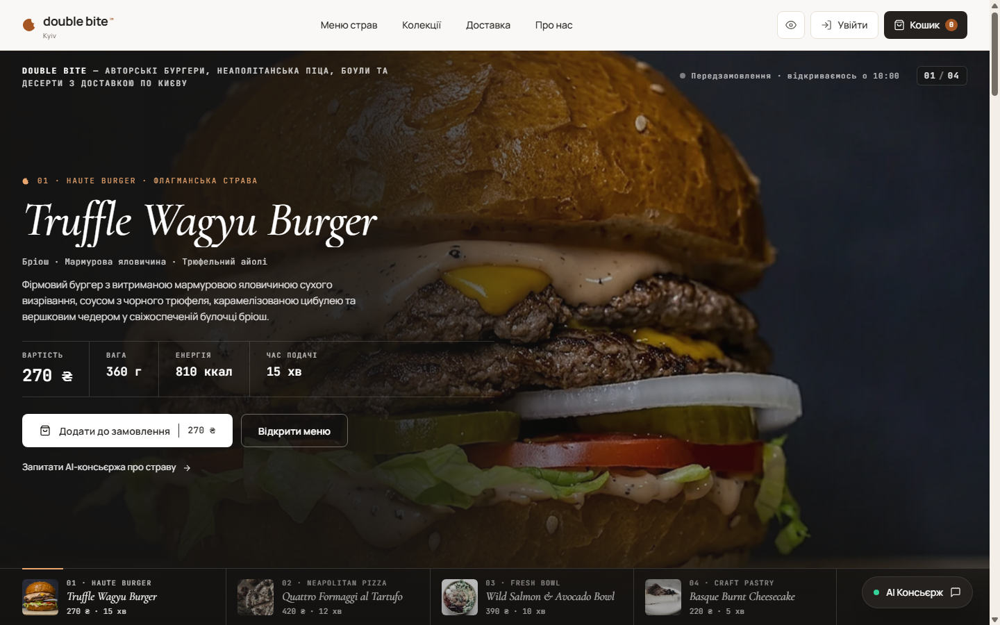
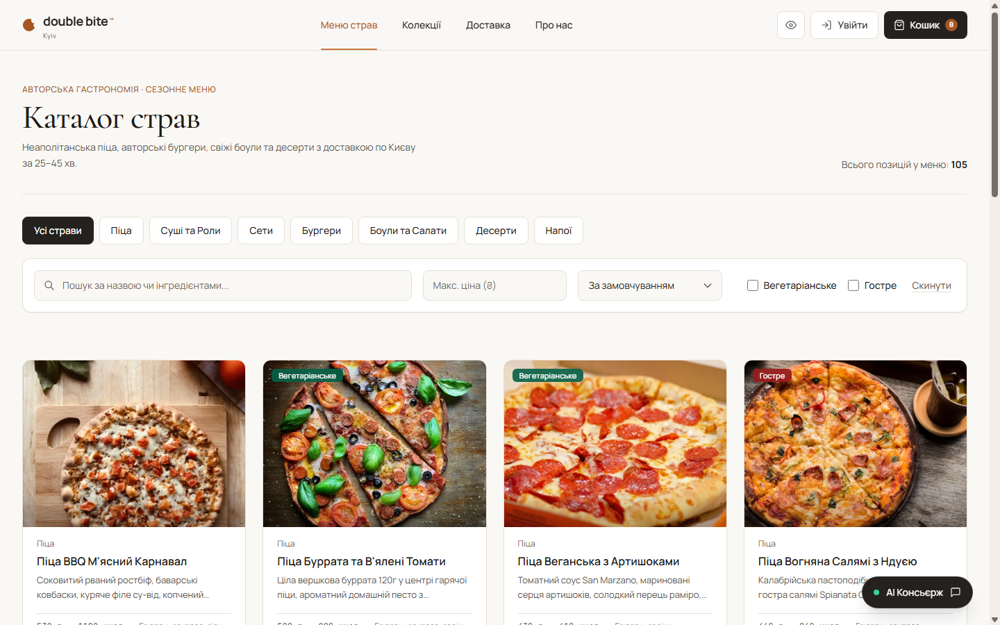
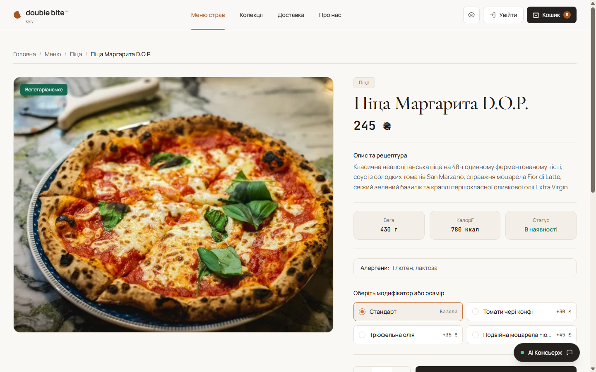
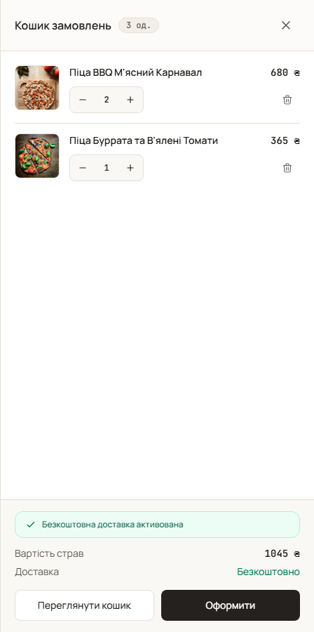
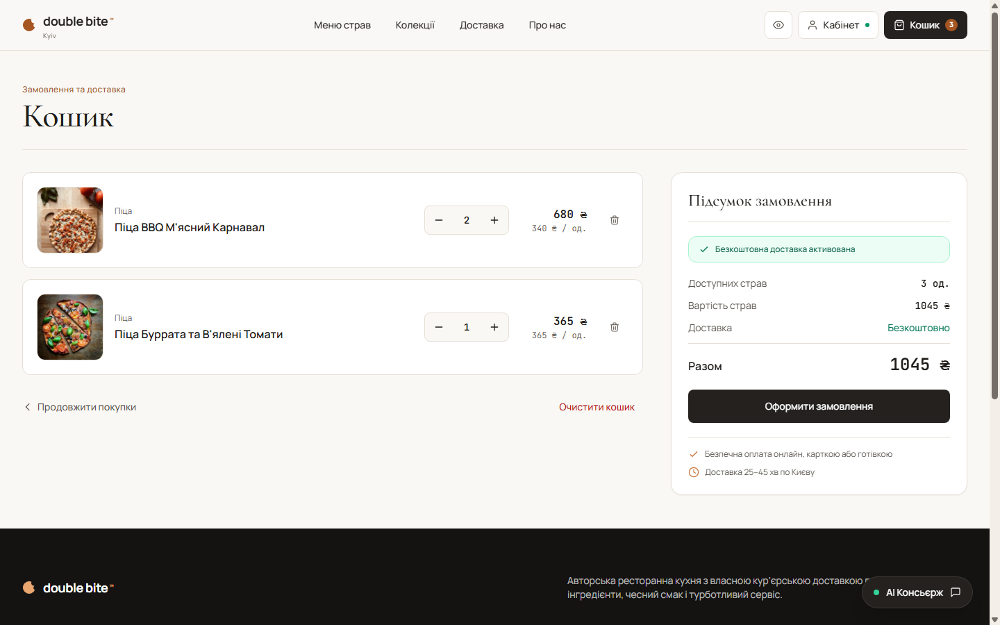
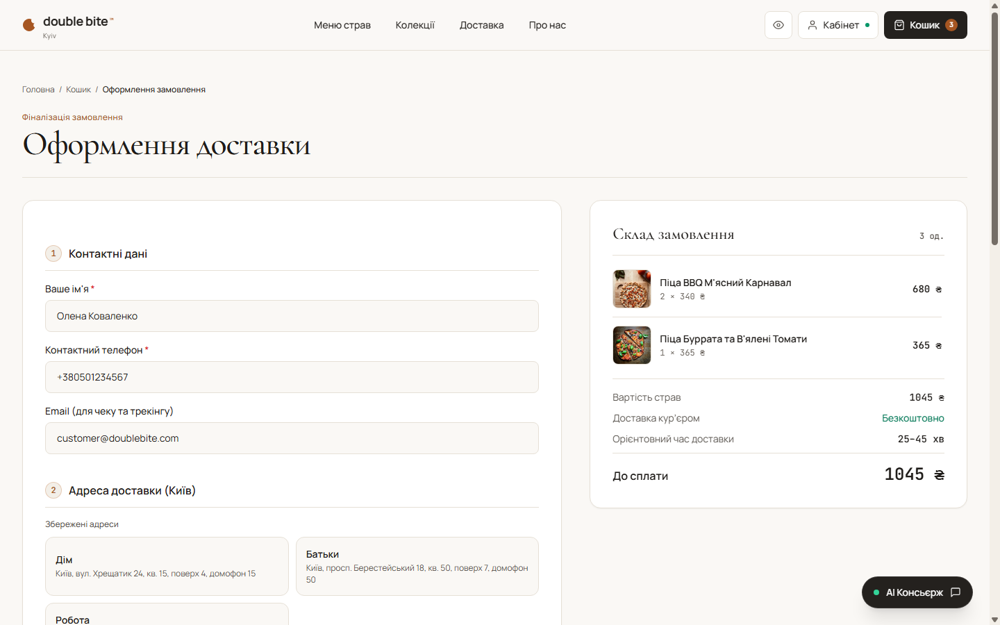
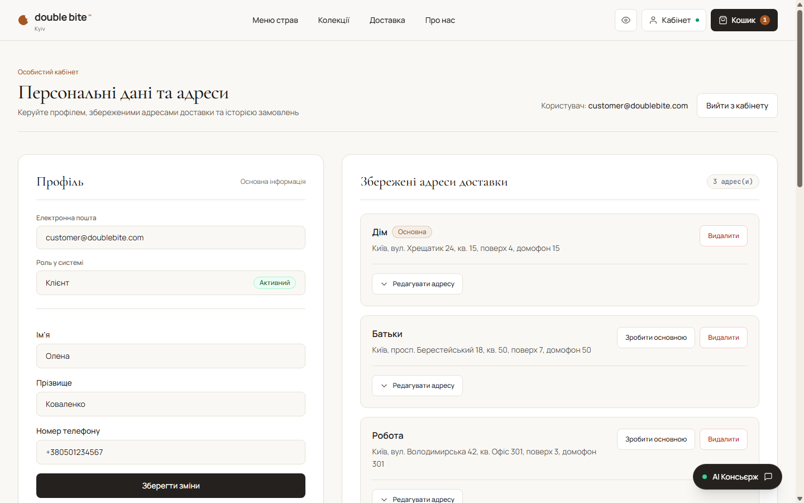
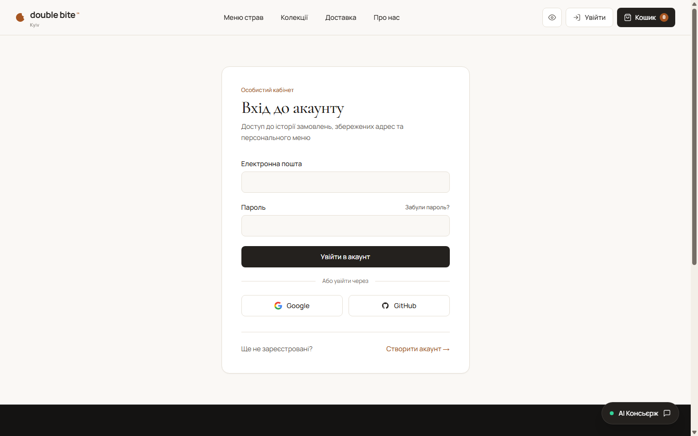
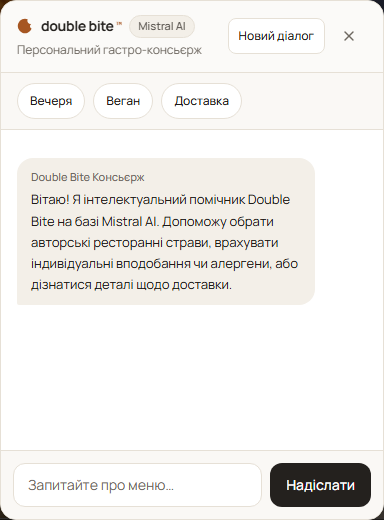
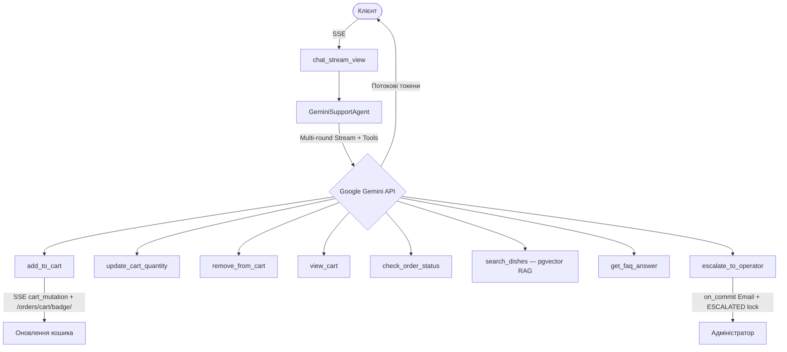

# Double Bite

Платформа онлайн-замовлення їжі з AI-чатботом підтримки 24/7.

| Releases & Framework | Data & Infrastructure | Security & AI | CI & Project Info |
| :---: | :---: | :---: | :---: |
| [](https://github.com/iDeash123/DoubleBite)<br>[](https://www.python.org/)<br>[](https://www.djangoproject.com/)<br>[](https://htmx.org/) | [-336791.svg?logo=postgresql&logoColor=white)](https://www.postgresql.org/)<br>[](https://redis.io/)<br>[](https://mailpit.axllent.org/)<br>[-635BFF.svg?logo=stripe&logoColor=white)](https://stripe.com/) | [](https://ai.google.dev/)<br>[](#ai-чатбот-підтримки)<br>[](#тестування-та-перевірки-якості)<br>[](https://tailwindcss.com/) | [](#тестування-та-перевірки-якості)<br>[](#тестування-та-перевірки-якості)<br>[](https://astral.sh/uv)<br>[](https://github.com/astral-sh/ruff)<br>[](LICENSE) |

---

## Можливості

- 🛒 Каталог страв з фільтрацією за категорією, ціною, дієтою та алергенами (HTMX 2 + нативні Django 6 Template Partials)
- 💳 Оплата через Stripe Checkout (картка, Apple/Google Pay) або при доставці (готівка / термінал кур'єру) з ідемпотентними webhook'ами та поверненнями
- 🤖 AI-чатбот на Google Gemini API з multi-round tool calling (`stream_async`) — керує кошиком, перевіряє статус замовлення, шукає по меню (RAG через PostgreSQL `pgvector` HNSW) та ескалує звернення оператору
- 📦 Трекінг замовлень у реальному часі (HTMX polling, state machine `PENDING → PAID → PREPARING → ON_WAY → DELIVERED` для `ONLINE` та `PENDING → PREPARING → ON_WAY → DELIVERED` для `CASH`/`CARD`, захищені гостьові посилання `?t=`)
- 🔐 Авторизація: email/пароль з обов'язковою верифікацією email + Google та GitHub OAuth 2.0 (`django-allauth` без автоперезапису паролів), атомарний Redis rate limiting (`HTTP 429`)
- 📧 Транзакційні email через `transaction.on_commit()`: підтвердження замовлення, чеки Stripe, повернення коштів, статуси доставки, скидання пароля, ескалація тікетів (Mailpit у dev)
- 🔍 SEO: `sitemap.xml`, `robots.txt`, ASCII-слаги, canonical, Open Graph, Schema.org JSON-LD (`json_script`)
- 🎨 UI без зовнішніх CDN — Tailwind CSS (standalone CLI), WhiteNoise для статики у prod, локальні шрифти, HTMX, Alpine.js, Lenis

---

## Скріншоти

<details>
<summary>📸 Розгорнути</summary>

### Головна · Каталог · Страва
| Головна сторінка | Каталог страв | Сторінка страви |
|:---:|:---:|:---:|
|  |  |  |
| Hero-секція з перемикачем страв та макросами КБЖВ | Фільтрація за категоріями, пошук, дієтичні бейджі | Опис, алергени, модифікатори, додавання в кошик |

### Кошик · Чекаут · Профіль
| Шторка кошика | Повний кошик | Чекаут | Профіль |
|:---:|:---:|:---:|:---:|
|  |  |  |  |
| Бічна панель на Alpine.js | Перелік позицій та вартість | Форма доставки, вибір оплати | Адреси, історія замовлень |

### Авторизація · AI-чатбот
| Вхід / Реєстрація | AI-чатбот підтримки |
|:---:|:---:|
|  |  |
| Email + Google/GitHub OAuth 2.0 | Стрімінг відповідей (SSE), tool calling, RAG |

</details>

---

## Стек

**Backend:** Django 6.0+, Uvicorn (ASGI) / WSGI, WhiteNoise, PostgreSQL 16 (`pgvector`), Redis 7  
**Frontend:** HTMX 2, Alpine.js, Tailwind CSS (standalone CLI), Lenis  
**AI:** Google Gemini API (`GEMINI_MODEL`, наприклад `gemini-2.5-flash`), `pgvector` RAG (1024-d `gemini-embedding-2` + `HnswIndex`)  
**Payments:** Stripe Checkout Sessions + Webhooks (HMAC) + Refunds (`idempotency_key`)  
**Auth:** `django-allauth` (Google, GitHub OAuth 2.0, обов'язкова верифікація email)  
**Infra:** Docker Compose (PostgreSQL 16 + `pgvector`, Redis 7, Mailpit), `uv`  
**Quality:** `pytest` + `pytest-django` (630 тестів), Ruff (строгі правила безпеки `S` + `BLE`)

---

## Швидкий старт

### Передумови

- Python 3.12+
- [uv](https://astral.sh/uv) (менеджер пакетів)
- Docker + Docker Compose
- Node.js (опційно — для тестів JS-санітайзера markdown `test_chat_markdown.py`)

### Встановлення

```bash
# 1. Клонувати репозиторій
git clone https://github.com/iDeash123/DoubleBite.git
cd double-bite

# 2. Встановити залежності
uv sync

# 3. Налаштувати змінні оточення
cp .env.example .env
# Заповніть обов'язкові значення: DB_PASSWORD, REDIS_PASSWORD, REDIS_URL,
# а також GEMINI_API_KEY, STRIPE_*, GOOGLE/GITHUB OAuth (за потреби)

# 4. Підняти інфраструктуру (PostgreSQL + pgvector, Redis, Mailpit)
docker compose up -d

# 5. Застосувати міграції
uv run python double-bite/manage.py migrate

# 6. Наповнити БД тестовими даними (100+ страв, FAQ, тестові акаунти)
uv run python double-bite/manage.py seed_db --force

# 7. Запустити сервер (ASGI — рекомендовано для SSE-стрімінгу AI)
uv run uvicorn config.asgi:application --app-dir double-bite --reload --port 8000

# Альтернативно (WSGI, також підтримує SSE через вбудований адаптер):
uv run python double-bite/manage.py runserver
```

Сайт: **http://localhost:8000**

### Корисні management-команди

```bash
# Перебудувати RAG-ембедінги страв через Google Gemini API (pgvector)
uv run python double-bite/manage.py rebuild_dish_embeddings --only-missing
uv run python double-bite/manage.py rebuild_dish_embeddings --force

# Очистити покинуті анонімні/порожні кошики (dry-run або реальне видалення)
uv run python double-bite/manage.py cleanup_abandoned_carts --days 7 --dry-run
uv run python double-bite/manage.py cleanup_abandoned_carts --days 7

# Очищення БД або генерація без завантаження зображень
uv run python double-bite/manage.py seed_db --force --clean-only
uv run python double-bite/manage.py seed_db --force --skip-images

# Снапшоти БД (зі скиданням PostgreSQL sequences)
uv run python double-bite/manage.py dump_snapshot
uv run python double-bite/manage.py load_snapshot
```

### Тестові акаунти (`DEBUG=True`)

| Роль | Email | Пароль |
|:---|:---|:---|
| Адміністратор | `admin@doublebite.com` | `admin12345` (або `ADMIN_PASSWORD` у `.env`) |
| Клієнт | `customer@doublebite.com` | `customer12345` (або `SEED_CUSTOMER_PASSWORD`) |
| Кур'єр | `courier@doublebite.com` | `courier12345` (або `SEED_COURIER_PASSWORD`) |

### Корисні URL

| Сервіс | URL |
|:---|:---|
| Сайт | [http://localhost:8000/](http://localhost:8000/) |
| Django Admin | [http://localhost:8000/admin/](http://localhost:8000/admin/) *(або шлях з `DJANGO_ADMIN_URL`)* |
| Mailpit (email) | [http://localhost:8025/](http://localhost:8025/) |
| Sitemap сайту | [http://localhost:8000/sitemap.xml](http://localhost:8000/sitemap.xml) |

---

## AI-чатбот підтримки

Чатбот працює на **Google Gemini API** (`GEMINI_MODEL`, наприклад `gemini-2.5-flash` у `.env.example`, OpenAI-compatible SSE endpoint). Відповіді стрімяться через SSE (ASGI `uvicorn` та WSGI-адаптер без `DJANGO_ALLOW_ASYNC_UNSAFE`) із multi-round tool calling (`max_rounds=3`), таймаутами та блокуванням AI-відповідей після ескалації на оператора (`HTTP 409`). Мова відповіді визначається автоматично за повідомленням клієнта.



### Tools

| Інструмент | Опис |
|:---|:---|
| `add_to_cart` | Додавання страви за ID або назвою (з валідацією доступності) |
| `update_cart_quantity` | Зміна кількості (0 = видалення, обмеження `<= 99`, підтримка `cart_item_id`) |
| `remove_from_cart` | Видалення страви з кошика |
| `view_cart` | Поточний вміст кошика (включно з `selected_options`) та сума |
| `check_order_status` | Статус замовлення за `order_number` або ID (з перевіркою власника — захист від IDOR) |
| `search_dishes` | Семантичний пошук по меню (`pgvector` `CosineDistance`, SQL-фільтри до `limit`, поріг релевантності) |
| `get_faq_answer` | Ранжовані відповіді з бази знань (доставка, оплата, графік) |
| `escalate_to_operator` | Атомарне створення тікету + блокування AI + email адміністратору після коміту |

---

## Тестування та перевірки якості

```bash
# Швидкий прогон усіх тестів (SQLite + LocMemCache: 621 passed, 9 Postgres/Redis-only skipped)
uv run python -m pytest

# Повний E2E-прогон проти реальних PostgreSQL + pgvector + Redis (docker compose up -d: 630 passed)
TEST_WITH_POSTGRES=1 TEST_WITH_REDIS=1 uv run python -m pytest

# По модулях
uv run python -m pytest double-bite/support/tests/   # AI-агент, tools, RAG, IDOR, SSE (129)
uv run python -m pytest double-bite/orders/tests/    # Кошик, Stripe, state machine, трекінг (159)
uv run python -m pytest double-bite/accounts/tests/  # Акаунти, OAuth, адреси, 429 lockout (110)
uv run python -m pytest double-bite/menu/tests/      # Каталог, вітрина, SEO, snapshots, seed (123)
uv run python -m pytest double-bite/config/tests/    # Прод-налаштування, XFF/rate-limit, email (93)
uv run python -m pytest double-bite/tests_e2e/       # PostgreSQL/pgvector, Redis Lua, concurrency, E2E (16)

# Строгий лінтер (включно з правилами безпеки Ruff S та BLE)
uv run ruff check .

# Перевірка міграцій та прод-конфігурації (DEBUG=False)
uv run python double-bite/manage.py migrate --check
uv run python double-bite/manage.py check --deploy --fail-level WARNING
```

---

## Структура проєкту

```text
double-bite/
├── double-bite/              # Django-проєкт
│   ├── accounts/             # Користувачі, OAuth 2.0, профілі, адреси доставки
│   ├── menu/                 # Головна вітрина, каталог страв, категорії, SEO, snapshots, embeddings
│   ├── orders/               # Кошик, замовлення, Stripe Checkout/Webhooks/Refunds, трекінг
│   ├── support/              # AI-чатбот (Google Gemini API, multi-round tool calling, pgvector RAG, SSE, пульт оператора)
│   │   └── agent/            # client.py, tools.py, prompts.py
│   ├── config/               # settings.py, security.py, transactions.py, validators.py, urls.py, asgi.py
│   ├── tests_e2e/            # Інтеграційні E2E та concurrency тести (PostgreSQL, pgvector, Redis, ASGI/WSGI)
│   ├── static/               # CSS, JS, шрифти (все локально, без CDN, WhiteNoise у prod)
│   └── templates/            # Django-шаблони + Django 6 partials + email-шаблони
├── docs/screenshots/         # Скріншоти інтерфейсу
├── docker-compose.yml        # PostgreSQL 16 (pgvector), Redis 7, Mailpit
├── pyproject.toml            # Залежності (uv) та строгі правила Ruff (E, F, I, UP, B, BLE, S)
├── uv.lock                   # Lockfile
├── pytest.ini                # Конфігурація pytest
├── .env.example              # Зразок змінних оточення
└── LICENSE                   # MIT
```

---

## Ліцензія

[MIT](LICENSE)
